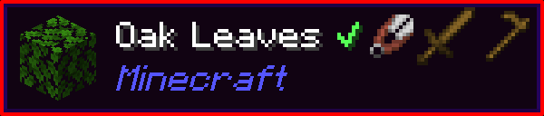
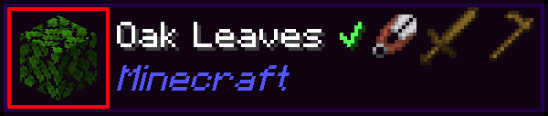
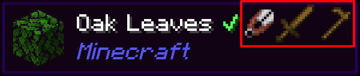

# What Am I Looking At? (WAILA)

## Info Providers

{width=50%}

`WailaInfoProvider` decides on both the icon and displayed text lines. The default implementation (`DefaultWailaInfoProviders.DEFAULT`) queries the registered [icon providers](#icon-providers) and [tool icon providers](#tool-icon-providers) to determine the icon and tool icons.

When creating a custom info provider, you'll usually want to build upon the default implementation and add your own lines to it:

```kotlin
@Init(stage = InitStage.PRE_PACK)
object WailaInfoProviders {
    
    val EXAMPLE_BLOCK = ExampleAddon.wailaInfoProvider("example_block") {
        priority = 999
        blocks = registryEntrySetOf(Blocks.EXAMPLE_BLOCK)
        infoProvider(DefaultWailaInfoProviders.DEFAULT) { player, block, blockState, info /*(1)!*/ ->
            info.copy(lines = info.lines + WailaLine(Component.text("Hello!"), WailaLine.Alignment.LEFT))
        }
    }
    
}

```

1. The `info` parameter comes from `DefaultWailaInfoProviders.DEFAULT` and contains the default icon and lines.

## Icon Providers

{width=50%}

`WailaIconProvider` decides on the icon to be displayed for a block. The icons are rendered during resource pack build, so changes require a rebuild.

You can decide whether you want to render an item model (`WailaIcon.Item`), a block state model (`WailaIcon.BlockState`), a model from a model file (`WailaIcon.Model`) or just pass through a texture (`WailaIcon.Texture`).

If multiple icon providers would provide an icon for the same block state, the one with the highest priority wins.

```kotlin
@Init(stage = InitStage.PRE_PACK)
object WailaIconProviders {
    
    val EXAMPLE_BLOCK = ExampleAddon.wailaIconProvider("example_block") {
        priority = 999
        blocks = registryEntrySetOf(Blocks.EXAMPLE_BLOCK)
        iconProvider { blockState ->
            // Decide on a WailaIcon based on the block state here
        }
    }
    
}
```

## Tool Icon Providers

{width=50%}

`ToolIconProvider` decides on the correct tool icons based on the tags of a block (refer to the [tools page](items/tools.md) to see how the tags are laid out). The results of all icon providers are combined. Switching to an entirely new icon that is not used by any other tool icon provider requires rebuilding the resource pack.

```kotlin
@Init(stage = InitStage.PRE_PACK)
object WailaToolIconProviders {
    
    val HAMMER = ExampleAddon.wailaToolIconProvider("hammer") {
        iconProvider { tags ->
            if (BlockTags.MINEABLE_HAMMER in tags) setOf(Key.key("example_addon", "item/hammer")) else emptySet()
        }
    }
    
}
```
